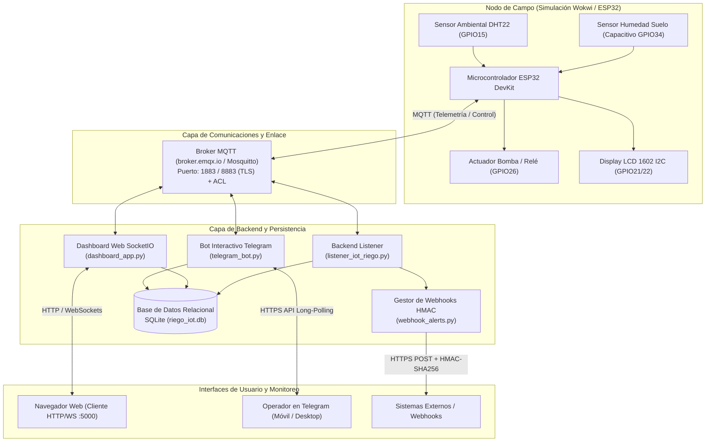

# Sistema IoT de Riego Automático y Monitoreo Agronómico

[](https://www.python.org/)
[](https://mqtt.org/)
[](https://flask.palletsprojects.com/)
[](https://core.telegram.org/bots)
[-brightgreen.svg)](#banco-de-pruebas-técnicas-y-de-seguridad)
[](LICENSE)

Sistema integral de telemando, monitoreo edafoclimático y control automatizado de riego para plantas de interior e invernaderos inteligentes. Implementa una arquitectura distribuida basada en microcontrolador **ESP32**, protocolo **MQTT** con seguridad en profundidad (**TLS v1.2/v1.3**, autenticación y listas de control de acceso **ACL**), **dashboard web en tiempo real** instrumentado con gráficos vectoriales SVG e interactividad WebSocket, telemando interactivo vía **Telegram Bot**, y pasarela de **webhooks criptográficos con firma HMAC-SHA256**.

---

## Tabla de Contenidos

- [Arquitectura del Sistema](#arquitectura-del-sistema)
- [Modelo Edafoclimático (FAO / Penman-Monteith)](#modelo-edafoclimático-fao--penman-monteith)
- [Estructura del Proyecto](#estructura-del-proyecto)
- [Instalación y Configuración](#instalación-y-configuración)
- [Puesta en Marcha de los Servicios](#puesta-en-marcha-de-los-servicios)
- [Dashboard Web de Control](#dashboard-web-de-control)
- [Módulo de Telemando Telegram](#módulo-de-telemando-telegram)
- [Banco de Pruebas Técnicas y de Seguridad](#banco-de-pruebas-técnicas-y-de-seguridad)
- [Documentación Técnica Adicional](#documentación-técnica-adicional)

---

## Arquitectura del Sistema



---

## Modelo Edafoclimático (FAO / Penman-Monteith)

El microcontrolador y el backend integran el modelo matemático agronómico de **Depreciación Máxima Permitida (MAD)** y **Déficit de Presión de Vapor (VPD)**:

| Parámetro Agronómico | Símbolo | Valor de Referencia | Descripción |
|---|---|---|---|
| Capacidad de Campo | `FC` | 35.0% VWC | Contenido volumétrico de agua a retención máxima sin escorrentía. |
| Punto de Marchitez Permanente | `PMP` | 15.0% VWC | Límite inferior donde la planta no puede extraer agua. |
| Agua Total Disponible | `TAW` | 20.0% VWC | $TAW = FC - PMP$. |
| Depreciación Máxima Permitida | `MAD` | 40% (0.40) | Fracción de agua extraíble antes de generar estrés hídrico. |
| **Umbral de Activación de Riego** | `VWC_trigger` | **27.0% VWC** | $VWC_{trigger} = FC - (MAD \times TAW)$. |
| Tiempo Máximo de Bombeo | `t_max` | 10.0 s | Temporizador de seguridad (fail-safe contra inundaciones). |

El **VPD (kPa)** se calcula mediante la ecuación de Magnus-Tetens recomendada por FAO Penman-Monteith a partir de la temperatura y humedad relativa del aire.

---

## Estructura del Proyecto

```
Proyecto-Wowki/
├── certs/                              # Infraestructura PKI y Certificados Digitales
│   ├── ca.crt, ca.key                  # Autoridad Certificadora Raíz (CA X.509)
│   ├── server.crt, server.key          # Certificado y clave del Servidor Broker
│   ├── client.crt, client.key          # Certificado y clave del Cliente TLS
│   ├── generate_certs.py               # Generador criptográfico multiplataforma (Python)
│   ├── generate_certs.sh               # Script de generación mediante OpenSSL (Bash)
│   └── README.md                       # Documentación técnica de la infraestructura PKI
├── config/                             # Políticas y configuración del sistema
│   └── acl_config.txt                  # Listas de control de acceso Mosquitto (Principio de menor privilegio)
├── docs/                               # Documentación y manuales técnicos
│   ├── Informe_Tecnico.md              # Informe de auditoría técnica, seguridad y resultados
│   └── Instrucciones_Despliegue.md     # Manual de despliegue en producción y entornos Edge
├── Images/                             # Esquemas circuitales, diagramas de flujo y evidencias
├── logs/                               # Registro operativo de ejecución (backend.log)
├── registros/                          # Evidencias auditables generadas por el sistema
│   ├── reporte_telemetria.png          # Gráfica de evolución edafoclimática (Matplotlib)
│   └── resultado_pruebas.json          # Evidencia de ejecución del banco de pruebas (13/13)
│
├── .env.example                        # Plantilla documentada de variables de entorno
├── .gitignore                          # Exclusión estricta de credenciales, claves y logs
├── requirements.txt                    # Dependencias y bibliotecas del entorno virtual
├── README.md                           # Documentación principal del repositorio
│
├── listener_iot_riego.py               # Backend listener: procesa telemetría MQTT, persiste y alerta
├── config.py                           # Gestión centralizada y tipada de variables de entorno
├── mqtt_security.py                    # Módulo de ciberseguridad MQTT, TLS, ACL y allowlists
├── dashboard_app.py                    # Dashboard web en tiempo real (Flask + SocketIO + SVG)
├── telegram_bot.py                     # Bot interactivo con menús inline y doble confirmación
├── webhook_alerts.py                   # Pasarela de eventos y alertas con firma HMAC-SHA256
├── graficas.py                         # Generador de reportes visuales estadísticos
└── test_security_and_integration.py    # Banco de 13 pruebas técnicas y de ciberseguridad
```

---

## Instalación y Configuración

### 1. Clonar el Repositorio y Crear el Entorno Virtual

```powershell
# En Windows PowerShell
git clone https://github.com/juan-marin192/sistema_riego_iot.git
cd sistema_riego_iot

python -m venv venv
.\venv\Scripts\Activate.ps1
```

```bash
# En Linux / macOS / Raspberry Pi
git clone https://github.com/juan-marin192/sistema_riego_iot.git
cd sistema_riego_iot

python3 -m venv venv
source venv/bin/activate
```

### 2. Instalar Dependencias

```powershell
pip install -r requirements.txt
```

### 3. Configuración de Variables de Entorno

Crear el archivo `.env` a partir de la plantilla:

```powershell
Copy-Item .env.example .env    # Windows
# cp .env.example .env         # Linux/macOS
```

Completar los parámetros requeridos en `.env`:
```env
# Broker MQTT
MQTT_BROKER=broker.emqx.io
MQTT_PORT=1883
MQTT_TOPIC_DATA=hogar/planta01/telemetria
MQTT_TOPIC_CTRL=hogar/planta01/control

# Telegram Bot
TELEGRAM_BOT_TOKEN=tu_token_aqui
TELEGRAM_CHAT_ID=tu_chat_id_aqui
AUTHORIZED_TELEGRAM_IDS=tu_chat_id_aqui

# Control de Polling (desacoplado para evitar conflicto HTTP 409)
ENABLE_TELEGRAM_POLLING=false
```

---

## Puesta en Marcha de los Servicios

El sistema opera con arquitectura modular en terminales independientes:

### Terminal 1: Backend Listener (Procesamiento y Persistencia)
```powershell
python listener_iot_riego.py
```
*Se encarga de suscribirse al tópico de telemetría, validar identidades de hardware, persistir mediciones en SQLite, evaluar umbrales críticos y despachar notificaciones automáticas.*

### Terminal 2: Dashboard Web (Monitoreo en Tiempo Real)
```powershell
python dashboard_app.py
```
*Inicia el servidor Flask en `http://localhost:5000` con comunicación bidireccional WebSocket y Chart.js.*

### Terminal 3: Bot Interactivo de Telegram (Telemando)
```powershell
python telegram_bot.py
```
*Procesa comandos interactivos del usuario (`/start`, `/estado`, `/riego_on`, `/riego_off`, `/alarmas`) mediante menús inline y confirmación de seguridad.*

---

## Dashboard Web de Control

La interfaz web en `http://localhost:5000` está optimizada para visualización industrial e instrumentación:

- **Identidad Visual Vectorial:** Imagotipos y pictogramas SVG de alta resolución adaptables a pantallas Retina/4K.
- **Tarjetas Métricas (KPIs):** Monitoreo en vivo de Humedad Volumétrica (VWC), Temperatura Ambiental, Humedad Relativa y Déficit de Presión de Vapor (VPD).
- **Medición de Latencia Real:** Cálculo de tiempo ida y vuelta (round-trip time) en milisegundos desde la emisión del comando hasta la confirmación de estado del actuador.
- **Gráfica Analítica en Vivo:** Traza temporal continua con curvas de VWC e indicación visual del umbral de activación MAD.
- **Telemando Manual de Actuadores:** Pulsadores de encendido y apagado de bomba con ventana modal de confirmación y feedback inmediato.
- **Bitácora de Auditoría:** Tabla de últimas 10 mediciones y panel de registro histórico de operaciones.

### Endpoints de la API REST

| Método | Endpoint | Descripción |
|---|---|---|
| `GET` | `/api/telemetria` | Retorna los últimos 50 registros de telemetría almacenados en JSON. |
| `GET` | `/api/estado` | Retorna el estado en tiempo real del sistema, actuador y broker. |
| `GET` | `/api/alarmas` | Retorna el historial de alarmas activadas por transgresión de umbral. |
| `GET` | `/api/operaciones` | Retorna la bitácora de comandos ejecutados en el sistema. |
| `POST` | `/api/control` | Transmite instrucciones `ON` u `OFF` al actuador mediante MQTT. |

---

## Módulo de Telemando Telegram

El bot implementa un canal interactivo seguro para la supervisión remota:

- **Control de Acceso:** Lista blanca (`AUTHORIZED_TELEGRAM_IDS`). Las solicitudes de usuarios no registrados son registradas y denegadas de inmediato.
- **Mecanismo de Doble Confirmación:** Las operaciones sobre el actuador (`/riego_on`, `/riego_off`) requieren confirmación explícita mediante botones inline para evitar pulsaciones accidentales.
- **Arquitectura Desacoplada sin Conflictos:** El listener gestiona las alertas salientes (`sendMessage`), mientras que `telegram_bot.py` procesa los comandos entrantes (`getUpdates`), eliminando conflictos `HTTP 409 Conflict`.
- **Manejo Defensivo de Formato:** Fallback automático ante errores de entidades Markdown para garantizar la entrega íntegra de cada notificación.

---

## Banco de Pruebas Técnicas y de Seguridad

El proyecto incluye un banco automatizado de 13 pruebas técnicas exhaustivas que certifican cada mecanismo de seguridad y comunicación:

```powershell
python test_security_and_integration.py
```

### Resultados de Certificación (13/13 Exitosas - 100%)

```text
==============================================================================
EJECUTANDO BANCO DE PRUEBAS TÉCNICAS Y DE SEGURIDAD IoT (FASE 5)
==============================================================================
[OK] [EXITOSA] 1. Rechazo de conexiones MQTT sin autenticación (0.5ms)
[OK] [EXITOSA] 2. Rechazo de conexiones con credenciales incorrectas (0.0ms)
[OK] [EXITOSA] 3. Validación de certificados TLS (77.0ms)
[OK] [EXITOSA] 4. Bloqueo de publicaciones en tópicos privados (ACL) (1.0ms)
[OK] [EXITOSA] 5. Bloqueo de comandos provenientes de usuarios no autorizados (0.1ms)
[OK] [EXITOSA] 6. Validación de identidad de los dispositivos (0.1ms)
[OK] [EXITOSA] 7. Encendido y apagado mediante usuarios autorizados (13.0ms)
[OK] [EXITOSA] 8. Recepción de telemetría en tiempo real (8.6ms)
[OK] [EXITOSA] 9. Medición real de latencia (12.4ms)
[OK] [EXITOSA] 10. Activación de alarmas por umbrales (109.5ms)
[OK] [EXITOSA] 11. Envío y recepción de notificaciones / Webhooks (615.4ms)
[OK] [EXITOSA] 12. Control de actuadores desde Telegram (0.2ms)
[OK] [EXITOSA] 13. Persistencia de información en la base de datos (2.1ms)
==============================================================================
RESUMEN FINAL: 13/13 PRUEBAS EXITOSAS (0 fallidas)
Reporte detallado guardado en 'registros/resultado_pruebas.json'
```

---

## Documentación Técnica Adicional

Para profundizar en el diseño e implementación del sistema, consulte los documentos en el directorio [docs/](file:///c:/Users/USUARIO/Downloads/Proyecto-Wowki/docs):

1. **[Informe Técnico de Auditoría y Certificación](file:///c:/Users/USUARIO/Downloads/Proyecto-Wowki/docs/Informe_Tecnico.md):** Memoria técnica completa, análisis de vulnerabilidades, arquitectura criptográfica PKI, modelos matemáticos y matrices de resultados.
2. **[Instrucciones de Despliegue en Servidores y Edge](file:///c:/Users/USUARIO/Downloads/Proyecto-Wowki/docs/Instrucciones_Despliegue.md):** Manual paso a paso para la configuración de brokers Mosquitto con TLS mutuo, servicios systemd en Linux y despliegue en campo.
3. **[Infraestructura de Certificados Digitales PKI](file:///c:/Users/USUARIO/Downloads/Proyecto-Wowki/certs/README.md):** Procedimientos de generación, renovación y firma de certificados digitales X.509.

---

*Sistema desarrollado para proyectos de investigación e instrumentación IoT aplicada a la agronomía y horticultura de precisión.*
