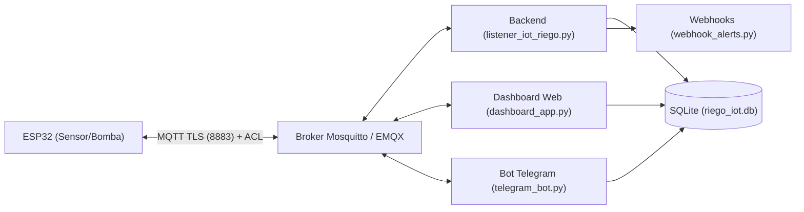

# Sistema IoT de Riego Automático y Monitoreo Agronómico

[](https://www.python.org/)
[](https://mqtt.org/)
[](https://flask.palletsprojects.com/)
[](https://core.telegram.org/bots)
[-brightgreen.svg)](#-banco-de-pruebas-técnicas)

Sistema integral de telemando, monitoreo edafoclimático y control de riego automático para invernaderos y cultivos inteligentes. Implementa arquitectura de ciberseguridad en profundidad con **cifrado TLS v1.2/v1.3**, listas de control de acceso (**ACL**), **dashboard web en tiempo real con medición de latencia**, telemando por **Telegram con menús interactivos y confirmación de seguridad**, y pasarela de **webhooks con firma criptográfica HMAC-SHA256**.

---

## Arquitectura del Sistema



---

## Estructura Organizada del Proyecto

```
Proyecto-Wowki/
├── certs/                              # Infraestructura PKI y Certificados Digitales
│   ├── ca.crt, ca.key                  # Autoridad Certificadora Raíz (CA)
│   ├── server.crt, server.key          # Certificado y clave del Servidor Broker
│   ├── client.crt, client.key          # Certificado y clave del Cliente Python
│   ├── generate_certs.py               # Generador multiplataforma (Windows/Linux/macOS)
│   ├── generate_certs.sh               # Script generador con OpenSSL (Bash)
│   └── README.md                       # Documentación de certificados
├── config/                             # Archivos de Configuración de Servicios
│   └── acl_config.txt                  # Reglas de Control de Acceso Mosquitto (ACL)
├── docs/                               # Manuales y Documentación Técnica Exhaustiva
│   ├── INFORME_TECNICO_FINAL.md        # Informe de auditoría técnica y resultados
│   ├── INSTRUCCIONES_DESPLIEGUE.md     # Guía detallada de despliegue paso a paso
│   ├── INSTRUCCIONES_GIT.md            # Guía segura para control de versiones en Git
│   └── Instrucciones-proyecto.md       # Términos de referencia del proyecto
├── Images/                             # Diagramas de flujo, esquemas de conexión y capturas
├── logs/                               # Registros operativos de ejecución
│   └── backend.log                     # Log rotativo del listener
├── registros/                          # Exportaciones y Evidencias de Ejecución
│   ├── reporte_telemetria.png          # Gráfica edafoclimática generada con Matplotlib
│   └── resultado_pruebas.json          # Evidencia JSON del banco de pruebas (13/13)
├── .env.example                        # Plantilla documentada de variables de entorno
├── .gitignore                          # Reglas estrictas de exclusión de Git
├── requirements.txt                    # Dependencias y bibliotecas de Python
├── README.md                           # Página de inicio del proyecto
│
├── listener_iot_riego.py               # SERVICIO: Backend Principal y Lógica de Riego
├── listener_iot_riego_BACKUP.py        # Copia de seguridad intacta del código original
├── config.py                           # Módulo centralizado de carga segura de variables
├── mqtt_security.py                    # Módulo de ciberseguridad MQTT, TLS y validación
├── dashboard_app.py                    # SERVICIO: Dashboard Web en Tiempo Real (Flask)
├── telegram_bot.py                     # SERVICIO: Bot Interactivo con Teclados Inline
├── webhook_alerts.py                   # SERVICIO: Gestor de Webhooks y Alertas (HMAC-SHA256)
├── graficas.py                         # Generador de reportes visuales estadísticos
├── test_security_and_integration.py    # BANCO: 13 Pruebas Técnicas y de Seguridad
└── riego_iot.db                        # Base de datos SQLite del sistema
```

---

## Inicio Rápido (Quickstart)

### 1. Activar Entorno e Instalar Dependencias
```powershell
python -m venv venv
.\venv\Scripts\activate       # En Windows
# source venv/bin/activate    # En Linux / Raspberry Pi
pip install -r requirements.txt
```

### 2. Configurar Variables de Entorno
```powershell
Copy-Item .env.example .env    # Windows
# cp .env.example .env         # Linux
```
Edita `.env` con tus tokens y credenciales.

### 3. Ejecutar las Pruebas de Seguridad
```powershell
python test_security_and_integration.py
```
*(Verifica que las 13 pruebas técnicas reporten estado EXITOSA).*

### 4. Iniciar los Servicios
Puedes iniciar cada servicio según lo requieras:
- **Backend Listener:** `python listener_iot_riego.py`
- **Dashboard Web (localhost:5000):** `python dashboard_app.py`
- **Bot Interactivo de Telegram:** `python telegram_bot.py`

---

## Documentación Detallada

Para consultar los manuales exhaustivos, visita la carpeta `docs/`:

1. [Guía de Despliegue en Servidores y Edge (Linux/Raspberry Pi)](file:///c:/Users/USUARIO/Downloads/Proyecto-Wowki/docs/INSTRUCCIONES_DESPLIEGUE.md)
2. [Guía Segura para el Cargue en Repositorio Git](file:///c:/Users/USUARIO/Downloads/Proyecto-Wowki/docs/INSTRUCCIONES_GIT.md)
3. [Informe Técnico Final de Auditoría y Certificación](file:///c:/Users/USUARIO/Downloads/Proyecto-Wowki/docs/INFORME_TECNICO_FINAL.md)

---

## Banco de Pruebas Técnicas

El script `test_security_and_integration.py` valida automáticamente:
1. Rechazo de conexiones MQTT anónimas.
2. Rechazo de conexiones con credenciales erróneas (`rc=5`).
3. Validación criptográfica de certificados X.509 y contexto SSL.
4. Restricción de publicaciones en tópicos privados mediante ACL.
5. Bloqueo de comandos emitidos por usuarios no registrados.
6. Validación de hardware genuino del ESP32 contra suplantación.
7. Encendido y apagado autorizado de actuadores.
8. Recepción y deserialización de telemetría en tiempo real.
9. Medición real de latencia ida y vuelta en milisegundos.
10. Detección y activación de alarmas de umbral edafoclimático.
11. Despacho de webhooks HTTP con firma HMAC y deduplicación.
12. Control interactivo por Telegram con menús de confirmación.
13. Integridad relacional en base de datos SQLite (5 tablas activas).
