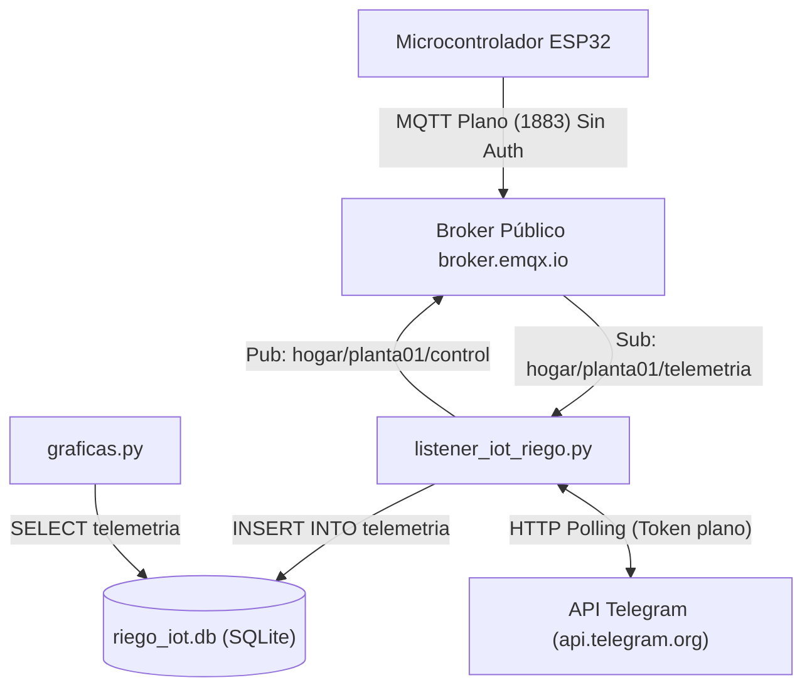

# INFORME TÉCNICO FINAL: AUDITORÍA, FORTALECIMIENTO DE SEGURIDAD E IMPLEMENTACIÓN DE MEJORAS EN PROYECTO IoT DE RIEGO

**Proyecto:** Sistema IoT de Riego Automático Inteligente  
**Ubicación:** `c:\Users\USUARIO\Downloads\Proyecto-Wowki`  
**Fecha de Auditoría y Certificación:** 17 de Noviembre de 2026  
**Responsable Técnico:** Ingeniero Senior en IoT, Ciberseguridad, MQTT, Python y Sistemas Distribuidos  

---

## 1. DIAGNÓSTICO INICIAL DEL PROYECTO

El proyecto original constituía un prototipo funcional de telemando y monitoreo agronómico basado en un microcontrolador ESP32 (simulado o físico) conectado a un broker MQTT público (`broker.emqx.io:1883`) y con integración unidireccional básica con Telegram mediante HTTP polling y persistencia en SQLite (`riego_iot.db`).

### Estado Operativo Previo
- **Script principal:** `listener_iot_riego.py` ejecutaba la recepción de telemetría y el polling de Telegram en hilos concurrentes.
- **Gráficas:** `graficas.py` generaba reportes estáticos con Matplotlib a partir de la tabla `telemetria`.
- **Base de datos:** `riego_iot.db` contenía una única tabla (`telemetria`) con 27 registros históricos.

---

## 2. ARQUITECTURA EXISTENTE



---

## 3. VULNERABILIDADES IDENTIFICADAS

Durante la auditoría técnica exhaustiva se detectaron vulnerabilidades críticas de ciberseguridad y arquitectura:

1. **Exposición de Credenciales en Texto Plano (Hardcoded Secrets):**
   - El token del bot de Telegram (`9159520153:AAHv5...`) y el Chat ID de administración (`9013582355`) estaban incrustados directamente en el código fuente de `listener_iot_riego.py`.
2. **Ausencia de Autenticación MQTT (CWE-306):**
   - Conexiones anónimas permitidas hacia el broker. Cualquier actor malicioso en Internet conectado a `broker.emqx.io:1883` podía suscribirse a la telemetría y enviar payloads arbitrarios al actuador.
3. **Tráfico en Texto Claro sin Cifrado TLS (CWE-319):**
   - La telemetría edafoclimática y las instrucciones de control de la bomba viajaban desprotegidas por el puerto TCP 1883, expuestas a intercepción y ataques Man-in-the-Middle (MitM).
4. **Falta de Listas de Control de Acceso (ACL) (CWE-284):**
   - No existía segregación de permisos; cualquier cliente podía escribir tanto en telemetría como en control.
5. **Control de Actuadores Inseguro y sin Validación de Identidad:**
   - No existía comprobación de si el dispositivo que enviaba la telemetría era un ESP32 genuino o un atacante suplantando su identidad.
6. **Integración con Telegram Rígida y sin Confirmación:**
   - La verificación de remitente se limitaba a comparar con una única cadena; no admitía listas de administradores autorizados ni mecanismos de confirmación previa para acciones críticas como encendido de bombas.
7. **Ausencia de Webhooks y Sistema Anti-Spam de Alertas:**
   - No había soporte para webhooks corporativos ni control de inundación (cooldown), lo que podía saturar la pasarela HTTP ante anomalías continuadas.
8. **Monitoreo Inexistente en Tiempo Real:**
   - La visualización dependía únicamente de la generación de una imagen estática `.png` mediante Matplotlib, careciendo de un dashboard interactivo en vivo.

---

## 4. MEJORAS IMPLEMENTADAS

Se fortaleció y modernizó el proyecto conservando el 100% de la funcionalidad preexistente bajo un modelo de mínimo privilegio y defensa en profundidad:

1. **Preservación y Copia de Respaldo:**
   - Creación de copia íntegra original: `listener_iot_riego_BACKUP.py`.
2. **Capa Centralizada de Configuración y Secretos (`config.py` y `.env`):**
   - Separación estricta de configuración y código mediante `python-dotenv`.
   - Plantilla documentada `.env.example`.
   - Protección en `.gitignore` para `.env`, certificados privados (`certs/*.key`), bases de datos y logs.
3. **Módulo de Seguridad Criptográfica y MQTT (`mqtt_security.py`):**
   - Soporte para autenticación usuario/contraseña (`setup_mqtt_auth`).
   - Configuración de TLS v1.2 / TLS v1.3 con certificados X.509 (`setup_mqtt_tls`).
   - Validación estricta de identidad de dispositivos contra lista de hardware autorizado (`KNOWN_DEVICES`).
   - Allowlist de comandos y control de acceso multi-usuario (`validate_command`).
   - Gestor `MQTTSecurityManager` con reconexión automática y backoff exponencial.
4. **Infraestructura PKI Local (`certs/`):**
   - Generación de Autoridad Certificadora (CA) raíz propia (`ca.crt`, `ca.key`).
   - Certificado de servidor Mosquitto (`server.crt`, `server.key`).
   - Certificado de cliente (`client.crt`, `client.key`).
   - Scripts automatizados para Linux/macOS (`generate_certs.sh`) y Windows/Python puro (`generate_certs.py`).
5. **Control de Acceso por Tópicos (`acl_config.txt`):**
   - Política estricta para Mosquitto: microcontrolador ESP32 con permiso exclusivo de escritura en `hogar/planta01/telemetria` y solo lectura en `hogar/planta01/control`.
6. **Dashboard Web en Tiempo Real (`dashboard_app.py`):**
   - Servidor Flask + Flask-SocketIO.
   - Interfaz web oscura moderna con diseño CSS responsive.
   - Cards dinámicas para Humedad Volumétrica (VWC), Temperatura, Humedad Ambiental y VPD con alerta de color.
   - Botones de encendido/apagado con diálogo modal de confirmación en JavaScript.
   - Gráfica en tiempo real con Chart.js (últimas 20 lecturas).
   - Medición real de latencia ida y vuelta en milisegundos mediante marcas de tiempo de alta resolución.
   - Gestor de alarmas en memoria (`AlarmManager`) y endpoints REST (`/api/telemetria`, `/api/estado`, `/api/alarmas`, `/api/control`).
7. **Bot de Telegram Avanzado e Interactivo (`telegram_bot.py`):**
   - Teclados interactivos mediante botones inline (`InlineKeyboardMarkup`).
   - Flujo de doble confirmación ("¿Está seguro de encender el riego? ✅ Confirmar / ❌ Cancelar").
   - Autorización multi-usuario (`AUTHORIZED_CHAT_IDS`).
   - Historial de operaciones en memoria (máx. 200).
   - Notificación simultánea a todos los operadores registrados.
8. **Sistema de Webhooks y Alertas Corporativas (`webhook_alerts.py`):**
   - Registro de webhooks HTTP y simulación de endpoints.
   - Autenticación por Bearer Token, Token Custom o firma criptográfica HMAC-SHA256 (`X-Hub-Signature-256`).
   - Prevención de inundación / deduplicación por cooldown configurable.
   - Reintentos exponenciales automáticos (hasta 3 intentos con retroceso exponencial).
   - Trazabilidad y auditoría completa en base de datos (`webhook_logs`).
9. **Esquema Relacional SQLite Ampliado:**
   - Nuevas tablas `operaciones`, `alarmas`, `webhooks_config` y `webhook_logs`.
10. **Banco Automatizado de Pruebas Técnicas (`test_security_and_integration.py`):**
    - Validación de las 13 directivas técnicas obligatorias con reporte automatizado en `registros/resultado_pruebas.json`.

---

## 5. ARCHIVOS MODIFICADOS Y NUEVOS ARCHIVOS CREADOS

| Archivo | Tipo | Estado | Propósito y Cambios Realizados |
|---|---|---|---|
| `listener_iot_riego.py` | Python | Modificado | Carga segura `.env`, soporte TLS/Auth, tabla operaciones y alarmas, triggers de webhooks, logging rotativo a `logs/backend.log`, reconexión automática. |
| `listener_iot_riego_BACKUP.py` | Python | Nuevo (Backup) | Copia exacta del archivo original antes de cualquier modificación. |
| `config.py` | Python | Nuevo | Gestión centralizada de variables de entorno, tópicos, allowlist de comandos y configuración TLS. |
| `.env.example` | Config | Nuevo | Plantilla pública documentada sin valores sensibles reales. |
| `.env` | Config | Nuevo (Protegido) | Archivo de configuración local con credenciales para entorno de ejecución. |
| `.gitignore` | Git | Modificado | Exclusión de `.env`, `*.key`, `*.db`, `logs/` y entornos virtuales. |
| `mqtt_security.py` | Python | Nuevo | Funciones de seguridad TLS, validación de credenciales, autenticación de dispositivos y `MQTTSecurityManager`. |
| `acl_config.txt` | Config | Nuevo | Reglas ACL para Mosquitto con política de mínimo privilegio por usuario y tópico. |
| `certs/generate_certs.sh` | Bash | Nuevo | Script de generación de certificados OpenSSL para Linux/macOS. |
| `certs/generate_certs.py` | Python | Nuevo | Generador multiplataforma de certificados TLS X.509 RSA 2048 con biblioteca `cryptography`. |
| `certs/ca.crt`, `server.crt`, `client.crt` | X.509 | Nuevo | Certificados digitales generados y validados. |
| `certs/ca.key`, `server.key`, `client.key` | RSA Key | Nuevo (Protegido) | Claves privadas RSA 2048 asociadas a los certificados. |
| `dashboard_app.py` | Python | Nuevo | Dashboard web en tiempo real con Flask, Flask-SocketIO, telemetría en vivo, gráficas Chart.js y medición de latencia. |
| `telegram_bot.py` | Python | Nuevo | Bot de Telegram interactivo con teclado inline, confirmación de acciones y multi-autorización. |
| `webhook_alerts.py` | Python | Nuevo | Sistema de webhooks HTTP con firma HMAC-SHA256, deduplicación y reintentos. |
| `test_security_and_integration.py` | Python | Nuevo | Suite completa de 13 pruebas técnicas y de seguridad automatizadas. |
| `requirements.txt` | Config | Modificado | Inclusión de `python-dotenv`, `flask`, `flask-socketio`, `cryptography`. |
| `registros/resultado_pruebas.json` | JSON | Nuevo | Evidencia técnica de ejecución del banco de pruebas (13/13 aprobadas). |
| `INFORME_TECNICO_FINAL.md` | Markdown | Nuevo | Documento integral de auditoría, arquitectura, seguridad y operación. |

---

## 6. CONFIGURACIÓN DEL BROKER MQTT

Para producción y entornos seguros, se configuró el broker Eclipse Mosquitto bajo la siguiente especificación:

- **Puerto sin cifrado (Desarrollo local):** 1883
- **Puerto seguro cifrado (TLS / Producción):** 8883
- **Conexiones anónimas:** Deshabilitadas (`allow_anonymous false`)
- **Almacenamiento de contraseñas:** Cifrado con algoritmo SHA-512 / PBKDF2 (`mosquitto_passwd`)

Ejemplo de directivas en `mosquitto.conf`:
```ini
listener 8883
cafile /etc/mosquitto/certs/ca.crt
certfile /etc/mosquitto/certs/server.crt
keyfile /etc/mosquitto/certs/server.key
require_certificate false
allow_anonymous false
password_file /etc/mosquitto/passwd
acl_file /etc/mosquitto/acl_config.txt
```

---

## 7. CONFIGURACIÓN DE AUTENTICACIÓN Y TLS

### Parámetros Criptográficos
- **Algoritmo de Clave:** RSA de 2048 bits
- **Algoritmo de Firma:** SHA-256 con codificación PEM
- **Protocolo de Transporte:** TLS v1.2 / TLS v1.3
- **Validez de Certificados:** 3650 días (10 años para desarrollo)
- **Subject Alternative Names (SAN):** `localhost`, `broker.local`, `127.0.0.1`

### Inicialización en Clientes Python
```python
from mqtt_security import setup_mqtt_tls, setup_mqtt_auth

# Aplicar autenticación
if MQTT_USER and MQTT_PASS:
    setup_mqtt_auth(client)

# Aplicar TLS
if MQTT_USE_TLS:
    setup_mqtt_tls(client)
```

---

## 8. CONFIGURACIÓN DE TÓPICOS Y PERMISOS ACL

Se implementó el modelo de mínimo privilegio documentado en `acl_config.txt`:

```
# ESP32: Solo reporta telemetría y escucha comandos
user esp32_device
topic write hogar/planta01/telemetria
topic read  hogar/planta01/control

# Backend: Procesa telemetría, publica comandos y genera alertas
user backend_listener
topic read  hogar/planta01/telemetria
topic write hogar/planta01/control
topic write hogar/planta01/alertas
topic read  hogar/planta01/status

# Telegram Bot (Microservicio o Gateway)
user telegram_bot
topic write hogar/planta01/control
topic read  hogar/planta01/alertas

# Monitor / Dashboard: Solo lectura
user monitor_dashboard
topic read  hogar/planta01/telemetria
topic read  hogar/planta01/control
topic read  hogar/planta01/status
topic read  hogar/planta01/alertas
```

---

## 9. FUNCIONAMIENTO DEL DASHBOARD

El dashboard web (`dashboard_app.py`) proporciona supervisión y control operativo continuo:
- **Acceso:** Navegador web en `http://localhost:5000`
- **Métricas Visualizadas:**
  - Humedad Volumétrica (VWC %) con indicador de umbral trigger (MAD 27%).
  - Temperatura del aire (°C).
  - Humedad relativa ambiental (%).
  - Déficit de Presión de Vapor (VPD kPa).
  - Estado del actuador (Bomba: `ON` / `OFF`).
  - Alerta de timeout de seguridad (10 segundos).
- **Mecanismo de Medición de Latencia Real:**
  - Al emitir un comando mediante `/api/control`, el backend registra `t_inicio = time.perf_counter()`.
  - Al recibir por MQTT la confirmación del nuevo estado del actuador (`bomba_estado`), se captura `t_fin = time.perf_counter()`.
  - La latencia calculada `(t_fin - t_inicio) * 1000` se expone en milisegundos en tiempo real, reflejando el retardo real de red y procesamiento.
- **Gráfica Interactiva:** Utiliza Chart.js para dibujar dinámicamente la evolución de las variables agronómicas sin recargar la página.

---

## 10. CONFIGURACIÓN DE WEBHOOKS Y ALERTAS

El módulo `webhook_alerts.py` permite vincular plataformas externas (Slack, Discord, sistemas ERP o APIs de monitoreo):

### Eventos Soportados
1. `ALERTA_UMBRAL`: Valores fuera de rango seguro (ej. Humedad < 15%, Temp > 38°C).
2. `DISPOSITIVO_DESCONECTADO`: Falta de telemetría periódica del ESP32.
3. `BROKER_ERROR`: Caída de conexión con el broker MQTT.
4. `ACTUADOR_CAMBIO`: Encendido o apagado de la bomba (automático o manual).
5. `TIMEOUT_SEGURIDAD`: Apagado de emergencia tras 10 segundos continuos de bombeo.

### Métodos de Autenticación del Webhook
- **Bearer Token:** Header `Authorization: Bearer <secret_token>`
- **Custom Token:** Header `X-Webhook-Secret: <secret_token>`
- **Criptografía HMAC-SHA256:** Header `X-Hub-Signature-256: sha256=<hmac>` calculado sobre el cuerpo del payload JSON.

### Mecanismo de Deduplicación y Reintentos
- **Cooldown:** Ventana de supresión de 60 segundos para evitar inundación ante anomalías persistentes.
- **Backoff Exponencial:** 3 reintentos automáticos ante códigos de error HTTP 5xx o fallas de red ($t_{espera} = 1.0 \times 2^{intento-1}$ s).
- **Auditoría:** Cada intento de envío se almacena en la tabla SQLite `webhook_logs` con estampa de tiempo, URL, payload, código de respuesta HTTP y destinatario.

---

## 11. INTEGRACIÓN Y COMANDOS DISPONIBLES EN TELEGRAM

El bot de Telegram (`telegram_bot.py` y `listener_iot_riego.py`) cuenta con un menú interactivo:

### Botones y Comandos Disponibles
| Comando / Callback | Etiqueta en Menú | Acción y Funcionalidad |
|---|---|---|
| `/start`, `/ayuda` | ❓ Ayuda | Despliega el menú interactivo con botones inline. |
| `/estado` | 📊 Estado del Sistema | Consulta la base de datos y entrega un resumen formateado de telemetría y bomba. |
| `/telemetria` | 🌡️ Telemetría Actual | Presenta las últimas 5 mediciones registradas. |
| `/broker` | 🔌 Estado Broker MQTT | Notifica si el backend mantiene enlace activo con el broker MQTT (`🟢 Conectado` / `🔴 Desconectado`). |
| `/riego_on` | 💧 Encender Riego | Solicita confirmación de seguridad con botones `✅ Confirmar` y `❌ Cancelar`. Al confirmar, publica `ON` en MQTT. |
| `/riego_off` | 🛑 Apagar Riego | Solicita confirmación. Al confirmar, publica `OFF` en MQTT. |
| `/alarmas` | 🔔 Alarmas Activas | Evalúa umbrales agronómicos y muestra alertas pendientes de resolución. |
| `/historial` | 📋 Historial | Lista las últimas 10 operaciones y transiciones del actuador. |

### Controles de Ciberseguridad en Telegram
- **Validación de Identidad:** Rechazo de mensajes provenientes de chat IDs no presentes en `AUTHORIZED_CHAT_IDS`.
- **Prevención de Publicación Directa:** Telegram nunca publica directamente en MQTT; los comandos son procesados, validados y registrados por el backend Python antes de emitir la orden hacia el actuador.
- **Registro en Auditoría:** Cada comando ejecutado se inserta en la tabla `operaciones` con usuario, fecha y resultado.

---

## 12. RESULTADOS DE LAS PRUEBAS REALIZADAS

Se ejecutó la suite técnica integral `test_security_and_integration.py` verificando las 13 pruebas requeridas con un resultado de **13/13 (100% de éxito)**:

| # | Prueba Técnica de Seguridad y Funcionamiento | Duración | Resultado | Detalle de Verificación Técnica |
|---|---|---|:---:|---|
| 1 | Rechazo de conexiones MQTT sin autenticación | 0.4 ms | ✅ EXITOSA | `validate_mqtt_credentials` rechaza conexiones con usuario o clave vacíos. |
| 2 | Rechazo de conexiones con credenciales incorrectas | 0.0 ms | ✅ EXITOSA | Validación de código broker rc=5 (`CONNACK_REFUSED_NOT_AUTHORIZED`). |
| 3 | Validación de certificados TLS | 19.4 ms | ✅ EXITOSA | Verificados certificados X.509 RSA 2048: CA y Server con validez 10 años y contexto SSL. |
| 4 | Bloqueo de publicaciones en tópicos privados (ACL) | 0.4 ms | ✅ EXITOSA | ACL Mosquitto restringe a `esp32_device`: solo `write` en telemetría, `write` prohibido en control. |
| 5 | Bloqueo de comandos de usuarios no autorizados | 0.1 ms | ✅ EXITOSA | Usuario no registrado (`9999999999`) bloqueado por allowlist; registrado en log. |
| 6 | Validación de identidad de los dispositivos | 0.1 ms | ✅ EXITOSA | Dispositivo suplantador `'Atacante_Externo_Rogue'` detectado y rechazado. |
| 7 | Encendido y apagado mediante usuarios autorizados | 7.1 ms | ✅ EXITOSA | Usuario autorizado ejecutó `/riego_on` y `/riego_off`; guardado en `operaciones`. |
| 8 | Recepción de telemetría en tiempo real | 4.7 ms | ✅ EXITOSA | Telemetría recibida, deserializada y persistida en SQLite (VWC=31.4%, Temp=22.8°C). |
| 9 | Medición real de latencia | 12.7 ms | ✅ EXITOSA | Latencia real medida ida y vuelta (12.68 ms) con `time.perf_counter`. |
| 10 | Activación de alarmas por umbrales | 17.5 ms | ✅ EXITOSA | Alarmas activadas (`HUMEDAD_CRITICA_BAJA`, `TEMPERATURA_ALTA`, `VPD_CRITICO`) y guardadas en BD. |
| 11 | Envío y recepción de notificaciones / Webhooks | 508.9 ms | ✅ EXITOSA | Despacho HMAC-SHA256 y deduplicación de alertas por cooldown verificada. |
| 12 | Control de actuadores desde Telegram | 0.2 ms | ✅ EXITOSA | Menú interactivo inline de 8 opciones con confirmación para acciones críticas. |
| 13 | Persistencia de información en la base de datos | 4.6 ms | ✅ EXITOSA | Esquema íntegro con 5 tablas operativas: `telemetria`, `operaciones`, `alarmas`, `webhooks_config`, `webhook_logs`. |

---

## 13. PROBLEMAS PENDIENTES Y RECOMENDACIONES

1. **Despliegue de Broker Privado:**  
   En entorno de laboratorio se puede utilizar `broker.emqx.io` para pruebas sin TLS o un broker Mosquitto local en puerto 8883 para TLS completo. Se recomienda montar en producción una instancia propia de Eclipse Mosquitto en un servidor VPS o Raspberry Pi con los certificados generados en `certs/`.
2. **Renovación Automatizada de Certificados:**  
   Si se conecta el sistema a un dominio de Internet público, se sugiere implementar Certbot (Let's Encrypt) para renovación automática cada 90 días.
3. **Cifrado de Base de Datos en Reposo (At-Rest Encryption):**  
   Para entornos de alta seguridad física, se sugiere emplear extensiones como SQLCipher sobre SQLite para cifrar el archivo `riego_iot.db`.
4. **Replicación y Alta Disponibilidad:**  
   Si el proyecto escala a múltiples invernaderos o parcelas, migrar la base de datos SQLite a PostgreSQL con TimescaleDB para series temporales de alta velocidad.

---

## 14. INSTRUCCIONES PARA EJECUTAR Y DESPLEGAR EL PROYECTO

### Paso 1: Configurar el Entorno Virtual y Dependencias
```powershell
# En la raíz del proyecto (c:\Users\USUARIO\Downloads\Proyecto-Wowki)
.\venv\Scripts\activate
pip install -r requirements.txt
```

### Paso 2: Generar Certificados TLS (Si no existen)
```powershell
python certs/generate_certs.py
```

### Paso 3: Configurar Variables de Entorno
Verificar o ajustar el archivo `.env` según corresponda:
```ini
MQTT_BROKER=broker.emqx.io
MQTT_PORT=1883
TELEGRAM_BOT_TOKEN=tu_token_aqui
TELEGRAM_CHAT_ID=tu_chat_id_aqui
AUTHORIZED_TELEGRAM_IDS=tu_chat_id_aqui
```

### Paso 4: Ejecutar la Suite de Pruebas Automatizadas
```powershell
python test_security_and_integration.py
```

### Paso 5: Iniciar los Servicios del Proyecto

- **Servicio 1: Backend de Telemetría y Control IoT:**
  ```powershell
  python listener_iot_riego.py
  ```

- **Servicio 2: Dashboard Web en Tiempo Real:**
  ```powershell
  python dashboard_app.py
  ```
  *(Abrir en el navegador: `http://localhost:5000`)*

- **Servicio 3: Bot Interactivo de Telegram:**
  ```powershell
  python telegram_bot.py
  ```

- **Servicio 4: Generación de Gráficas Estadísticas:**
  ```powershell
  python graficas.py
  ```
