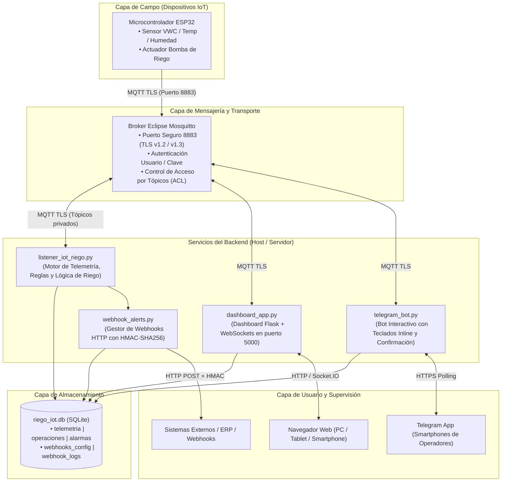

# GUÍA COMPLETA DE DESPLIEGUE: SISTEMA IoT DE RIEGO INTELIGENTE

**Proyecto:** Sistema IoT de Riego Automático y Monitoreo Agronómico  
**Versión:** 2.0 (Seguridad Fortalecida, MQTT TLS, ACL, Dashboard Web y Telegram)  
**Fecha:** Noviembre 2026  

---

## 1. Arquitectura y Topología de Despliegue

El sistema implementa una arquitectura modular desacoplada basada en microservicios ligeros que interactúan mediante el protocolo MQTT y una base de datos relacional SQLite centralizada:



---

## 2. Requisitos Previos

### Hardware Soportado:
- **Opción A (Servidor / Nube):** VPS o máquina virtual (Ubuntu 20.04/22.04/24.04, Debian 11/12, CentOS 9, Windows Server) con mínimo 1 vCPU y 1 GB de memoria RAM.
- **Opción B (Dispositivo Edge / Borde):** Raspberry Pi 3/4/5 o equivalente corriendo Raspberry Pi OS.
- **Opción C (Desarrollo Local):** PC con Windows 10/11, macOS o Linux.
- **Microcontrolador:** ESP32 NodeMCU / ESP32-WROOM con sensor de humedad volumétrica (ej. capacitivo v1.2) y módulo relé.

### Software Requerido:
- Python 3.10 o superior (verificar con `python --version`).
- Git (verificar con `git --version`).
- Broker MQTT: Eclipse Mosquitto (para despliegue seguro con TLS/ACL) o acceso a broker cloud (ej. EMQX Cloud / HiveMQ).

---

## 3. Despliegue Paso a Paso

### PASO 1: Clonar el Repositorio
```bash
git clone https://github.com/juan-marin192/sistema_riego_iot.git
cd sistema_riego_iot
```

---

### PASO 2: Crear y Activar el Entorno Virtual

**En Windows (PowerShell):**
```powershell
python -m venv venv
.\venv\Scripts\activate
```

**En Linux / Raspberry Pi / macOS:**
```bash
python3 -m venv venv
source venv/bin/activate
```

---

### PASO 3: Instalar Dependencias del Proyecto
Con el entorno virtual activado, instala las bibliotecas necesarias:
```bash
pip install --upgrade pip
pip install -r requirements.txt
```

*Las dependencias instaladas incluyen: `paho-mqtt`, `requests`, `matplotlib`, `python-dotenv`, `flask`, `flask-socketio`, `cryptography`.*

---

### PASO 4: Configurar Variables de Entorno (`.env`)

Copia la plantilla de configuración segura:

**En Windows:**
```powershell
Copy-Item .env.example .env
```

**En Linux / macOS:**
```bash
cp .env.example .env
```

Abre el archivo `.env` en tu editor preferido y ajusta los parámetros de tu entorno:

```ini
# =============================================================================
# BROKER MQTT
# =============================================================================
# Para desarrollo/pruebas puedes usar broker.emqx.io (puerto 1883, TLS=false).
# Para producción, usa tu propio servidor Mosquitto (puerto 8883, TLS=true).
MQTT_BROKER=broker.emqx.io
MQTT_PORT=1883
MQTT_USER=backend_listener
MQTT_PASS=TuContrasenaSeguraMqtt2026!
MQTT_CLIENT_ID=VSCode_Backend_Listener
MQTT_USE_TLS=false
MQTT_KEEPALIVE=60

# =============================================================================
# BOT DE TELEGRAM
# =============================================================================
# Generado con @BotFather en Telegram
TELEGRAM_BOT_TOKEN=9159520153:AAHv5qeorAPrXTUOO7iJyz9ORVnGxlz3_Ko

# Tu Chat ID (puedes obtenerlo enviando /start a @userinfobot en Telegram)
TELEGRAM_CHAT_ID=9013582355

# IDs autorizados separados por coma (solo estos podrán operar la bomba)
AUTHORIZED_TELEGRAM_IDS=9013582355

# =============================================================================
# TÓPICOS MQTT
# =============================================================================
MQTT_TOPIC_PREFIX=hogar/planta01

# =============================================================================
# CERTIFICADOS TLS
# =============================================================================
CERTS_DIR=./certs
TLS_CA_CERT=./certs/ca.crt
TLS_CLIENT_CERT=./certs/client.crt
TLS_CLIENT_KEY=./certs/client.key
TLS_VERSION=TLSv1_2
TLS_INSECURE=false

# =============================================================================
# BASE DE DATOS Y LOGS
# =============================================================================
DB_NAME=riego_iot.db
LOG_LEVEL=INFO
LOG_FILE=logs/backend.log
```

---

### PASO 5: Generar Certificados Digitales TLS X.509
Para cifrar las comunicaciones MQTT mediante TLS en tu broker:

```bash
python certs/generate_certs.py
```

Este script genera automáticamente en el directorio `certs/`:
- `ca.crt` y `ca.key`: Autoridad Certificadora Raíz propia.
- `server.crt` y `server.key`: Certificado y clave privada del servidor broker.
- `client.crt` y `client.key`: Certificado y clave privada del cliente Python.

*(En entornos Linux con OpenSSL instalado, también puedes utilizar alternativamente `bash certs/generate_certs.sh`).*

---

### PASO 6: Configurar el Broker Eclipse Mosquitto (Producción)

Si vas a utilizar un broker privado en Linux o Raspberry Pi:

1. **Instalar Mosquitto:**
   ```bash
   sudo apt update
   sudo apt install -y mosquitto mosquitto-clients
   ```

2. **Copiar certificados y archivo ACL:**
   ```bash
   sudo mkdir -p /etc/mosquitto/certs
   sudo cp certs/ca.crt certs/server.crt certs/server.key /etc/mosquitto/certs/
   sudo cp config/acl_config.txt /etc/mosquitto/acl_config.txt
   sudo chown -R mosquitto:mosquitto /etc/mosquitto/certs /etc/mosquitto/acl_config.txt
   ```

3. **Crear usuarios y contraseñas del sistema:**
   ```bash
   # Usuario para el microcontrolador ESP32
   sudo mosquitto_passwd -c /etc/mosquitto/passwd esp32_device
   
   # Usuario para el Backend Listener
   sudo mosquitto_passwd /etc/mosquitto/passwd backend_listener
   
   # Usuario para el Dashboard / Monitor
   sudo mosquitto_passwd /etc/mosquitto/passwd monitor_dashboard
   ```

4. **Configurar `/etc/mosquitto/mosquitto.conf`:**
   ```ini
   # Listener seguro cifrado con TLS
   listener 8883
   cafile /etc/mosquitto/certs/ca.crt
   certfile /etc/mosquitto/certs/server.crt
   keyfile /etc/mosquitto/certs/server.key
   
   # Seguridad y control de acceso
   allow_anonymous false
   password_file /etc/mosquitto/passwd
   acl_file /etc/mosquitto/acl_config.txt
   ```

5. **Reiniciar y habilitar Mosquitto:**
   ```bash
   sudo systemctl restart mosquitto
   sudo systemctl enable mosquitto
   ```

---

### PASO 7: Ejecutar la Suite de Pruebas Automatizadas
Antes de poner el sistema en producción, valida la integridad de todos los módulos:

```bash
python test_security_and_integration.py
```

**Resultado esperado:**
```
==============================================================================
RESUMEN FINAL: 13/13 PRUEBAS EXITOSAS (0 fallidas)
==============================================================================
Reporte detallado guardado en 'registros/resultado_pruebas.json'
```

---

## 4. Ejecución y Puesta en Marcha de los Servicios

El sistema se compone de 3 servicios principales que pueden ejecutarse de manera independiente o simultánea:

### Servicio 1: Backend de Telemetría y Automatización (`listener_iot_riego.py`)
Es el núcleo del sistema. Recibe la telemetría del sensor, evalúa la humedad contra el umbral MAD, decide el encendido automático de la bomba, vigila el timeout de 10s y dispara las alarmas y webhooks.

```bash
python listener_iot_riego.py
```

### Servicio 2: Dashboard Web en Tiempo Real (`dashboard_app.py`)
Levanta el servidor web Flask + SocketIO en el puerto 5000.

```bash
python dashboard_app.py
```
> **Acceso web:** Abre tu navegador en `http://localhost:5000` (o `http://<IP_DEL_SERVIDOR>:5000`).

### Servicio 3: Bot Interactivo de Telegram (`telegram_bot.py`)
Mantiene el canal de control interactivo mediante botones inline con los operadores autorizados.

```bash
python telegram_bot.py
```

---

## 5. Despliegue como Servicios de Sistema (`systemd` en Linux)

Para que los servicios se inicien automáticamente con el sistema operativo y se recuperen ante caídas o reinicios del servidor:

### 1. Servicio del Backend (`/etc/systemd/system/riego-backend.service`)
```ini
[Unit]
Description=Backend de Telemetria y Riego IoT
After=network.target mosquitto.service

[Service]
Type=simple
User=pi
WorkingDirectory=/home/pi/sistema_riego_iot
ExecStart=/home/pi/sistema_riego_iot/venv/bin/python listener_iot_riego.py
Restart=always
RestartSec=5
StandardOutput=append:/home/pi/sistema_riego_iot/logs/backend.log
StandardError=append:/home/pi/sistema_riego_iot/logs/backend.log

[Install]
WantedBy=multi-user.target
```

### 2. Servicio del Dashboard Web (`/etc/systemd/system/riego-dashboard.service`)
```ini
[Unit]
Description=Dashboard Web IoT de Riego en Tiempo Real
After=network.target

[Service]
Type=simple
User=pi
WorkingDirectory=/home/pi/sistema_riego_iot
ExecStart=/home/pi/sistema_riego_iot/venv/bin/python dashboard_app.py
Restart=always
RestartSec=5

[Install]
WantedBy=multi-user.target
```

### 3. Servicio del Bot de Telegram (`/etc/systemd/system/riego-telegram.service`)
```ini
[Unit]
Description=Bot Interactivo de Telegram IoT Riego
After=network.target

[Service]
Type=simple
User=pi
WorkingDirectory=/home/pi/sistema_riego_iot
ExecStart=/home/pi/sistema_riego_iot/venv/bin/python telegram_bot.py
Restart=always
RestartSec=5

[Install]
WantedBy=multi-user.target
```

### Activar e Iniciar todos los Servicios:
```bash
sudo systemctl daemon-reload
sudo systemctl enable riego-backend riego-dashboard riego-telegram
sudo systemctl start riego-backend riego-dashboard riego-telegram
```

### Comprobar Estado:
```bash
sudo systemctl status riego-backend
sudo systemctl status riego-dashboard
sudo systemctl status riego-telegram
```

---

## 6. Monitoreo y Solución de Problemas (Troubleshooting)

### Ver logs en vivo:
```bash
# Ver log del backend:
tail -f logs/backend.log

# Ver logs de systemd:
sudo journalctl -u riego-backend -f
```

### Problemas comunes:
1. **Error: `[Errno 11001] getaddrinfo failed` en Telegram:**
   - Causa: Pérdida momentánea de conexión a Internet en el servidor.
   - Solución: El hilo de Telegram reintenta automáticamente tras 2 segundos. Verifica la conectividad de red con `ping 8.8.8.8`.
2. **El microcontrolador no se conecta al Broker con TLS:**
   - Causa: Fecha y hora desfasada en el microcontrolador (imposibilita validar el certificado X.509) o falta del certificado CA raíz en la memoria flash del ESP32.
   - Solución: Configura un cliente SNTP en el ESP32 para sincronizar hora por NTP antes de iniciar la conexión TLS (`time(nullptr)`).
3. **Comando denegado en Telegram:**
   - Causa: Tu Chat ID no está en la variable `AUTHORIZED_TELEGRAM_IDS` de `.env`.
   - Solución: Agrega tu Chat ID en `.env` y reinicia el servicio.
